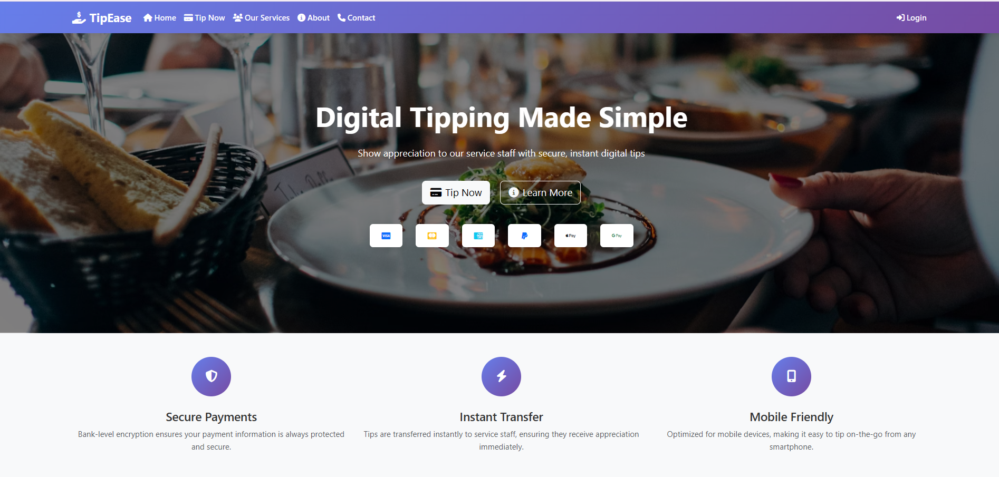

# TipEase — Digital Tipping Platform

TipEase is a Django web application for browsing waiter profiles and sending digital tips through Razorpay. It also includes a contact form and Django’s admin interface for managing application data.

## Features

- Browse waiter profiles and profile details
- Create Razorpay orders for tips (minimum ₹10)
- View the project’s home, services, and about pages
- Send messages through the contact form
- Manage records through Django admin
- Responsive interface with HTML templates and static assets

## Screenshots

| Home page | Tip payment |
| --- | --- |
|  |  |

## Tech stack

- Python and Django 5.2
- HTML, CSS, and JavaScript
- SQLite (the configured default database)
- Razorpay for payment order creation
- Django Jazzmin for the admin interface

## Run locally

### Requirements

- Python 3.10 or later
- A Razorpay account and API keys to test the payment flow

### Installation

Run these commands from the repository root:

```bash
git clone https://github.com/GURUPRASAD178/Tip_App.git
cd Tip_App/Tip
python -m venv .venv
```

Activate the virtual environment:

```bash
# macOS / Linux
source .venv/bin/activate

# Windows PowerShell
.venv\Scripts\Activate.ps1
```

Install dependencies and initialize the database:

```bash
python -m pip install -r ../requirements.txt
python -m pip install razorpay
python manage.py migrate
```

`Tip_App` imports the Razorpay SDK, but it is not currently listed in `requirements.txt`; the separate install command is therefore needed.

Start the development server:

```bash
python manage.py runserver
```

Open [http://127.0.0.1:8000/](http://127.0.0.1:8000/) in your browser. The Django admin is available at [http://127.0.0.1:8000/admin/](http://127.0.0.1:8000/admin/). To create an admin login, run `python manage.py createsuperuser` and follow the prompts.

## Payment configuration

The Razorpay key ID and secret are read from `Tip/Tip/settings.py`. Configure your own **test-mode** credentials there before trying payments. Never commit live payment credentials or other secrets to source control; use environment variables and secure deployment settings for any real deployment. Email settings in the same file should also be configured before using the contact form.

## Project layout

```text
Tip_App/
├── README.md
├── requirements.txt
├── screenshots/
└── Tip/
    ├── manage.py
    ├── Tip/          # Django project configuration
    └── Tip_App/      # Application, templates, and static files
```

## Security note

The checked-in Django settings currently contain secret values and have `DEBUG` enabled. Treat any committed credentials as exposed: rotate them, move secrets out of the repository, and set `DEBUG = False` with an appropriate `ALLOWED_HOSTS` before deployment. This repository is currently configured for local development, not production.
